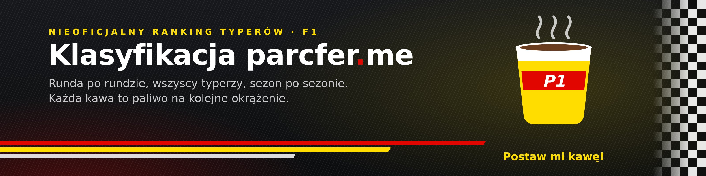

# parcferme-ranking

<a href="https://www.buymeacoffee.com/patrykw"></a>

<a href="https://www.buymeacoffee.com/patrykw"></a>

Nieoficjalna, fanowska klasyfikacja typerów konkursu [parcfer.me](https://parcfer.me) (F1), runda po rundzie. Ranking aktualizuje się sam po każdym rozliczonym GP.

**Strona:** https://patrykw-labs.github.io/parcferme-ranking/

> Projekt nie jest powiązany z parcfer.me ani z Formułą 1. Dane pochodzą z publicznego rankingu na [parcfer.me](https://parcfer.me) i należą do ich właścicieli.

## Funkcje

- **Tabela runda po rundzie** — suma punktów, miejsce i przyrost w każdej rundzie, strzałki zmiany miejsca (▲/▼), oznaczenia „↑100” (wejście do TOP 100) i „NOWY”. Trzy widoki: **TOP 100**, **Moja okolica** (±15 miejsc wokół Twojego nicka) i **Wszyscy** (strony po 100 osób). Tabela przewija się we własnym oknie z przyklejonym nagłówkiem.
- **Wyszukiwarka** po wszystkich uczestnikach; po wpisaniu pełnego nicka przycisk „Pokaż w tabeli” przenosi do jego wiersza.
- **Twoja pozycja** — po wpisaniu nicka: miejsce, punkty, zmiana miejsca, punkty w rundzie i strata do lidera, podświetlenie w tabeli, „📍 Pokaż mnie” w widoku Wszyscy oraz przycisk „🔗 Udostępnij”.
- **Kafelki rundy** — lider i podium, największy skok w TOP 100, najwięcej punktów w rundzie, aktywność (ile osób zdobyło punkty), rozrzut punktów w TOP 100 oraz lista **TOP 10**.
- **Forma** — tabela najlepszych z ostatnich 3 rund (suma punktów, z remisami).
- **Historia gracza** — kliknięcie dowolnego nicka otwiera wykres miejsca po każdej rundzie i tabelę wszystkich rund (obecne i najlepsze miejsce, średnia punktów na rundę).
- **Pojedynek** — dwa nicki obok siebie: różnica punktów po każdej rundzie na wykresie, bilans rund i tabela runda po rundzie.
- **Ex aequo** — przy równej liczbie punktów wspólne miejsce z „=” (np. „2=”) w całej stronie; pełny zakres miejsc w dymku po najechaniu. Strzałki zmian liczone są ze wspólnych miejsc.
- **Jasny i ciemny motyw**, wersja na telefon, podgląd linku (Open Graph) przy udostępnianiu na Messengerze czy Facebooku.

### Linki

| Adres | Co robi |
|---|---|
| `?nick=Pat` | podświetla gracza i otwiera „Moją okolicę” (nie nadpisuje nicka zapisanego w przeglądarce) |
| `?nick=Pat&vs=Kapexis` | otwiera pojedynek dwóch graczy |
| `?sezon=2026` | konkretny sezon (przy ≥2 sezonach w nagłówku pojawia się przełącznik) |

## Dane

- `data/<rok>.json` — lista rund, w każdej ranking `{ pos, name, points, id }`; `id` to numer użytkownika z parcfer.me.
- Spa R10: zapisany TOP 30, od Węgier R11 do Singapuru R17: TOP 100, od USA R18: pełny ranking wszystkich uczestników. Osoby spoza zapisanej czołówki mają w starszych rundach „> 30” / „> 100”.
- Uczestników rozróżnia `id`, więc powtarzające się nicki („Oskar”, „Oskar (2)”) nie mieszają się między rundami. W rundach do Singapuru R17 `id` dopisano wstecz po nicku (przy powtórzeniach po kolejności, sprawdzonej z ciągłością punktów).

## Aktualizacja po rundzie

**Automatycznie:** workflow `.github/workflows/update-ranking.yml` co 3 godziny uruchamia `python3 tools/add_round.py --auto`. Skrypt sprawdza na parcfer.me ostatnie rozliczone typowanie sezonu (numer rundy = kolejność typowania w sezonie, nazwa z `data/round_names.json`), a gdy ranking jest już przeliczony — dopisuje rundę, robi commit i zleca publikację na Pages. Nietypowe dane (spadek punktów, przyrost ponad 25) przerywają z błędem. Ręcznie: zakładka Actions → „Aktualizacja rankingu” → Run workflow.

**Ręcznie:** po przeliczeniu punktów na parcfer.me, a przed kolejnym GP (strona pokazuje tylko stan bieżący):

```
python3 tools/add_round.py "Meksyk R19"
```

Zamiast pobierania można podać `--html zapisana_strona.html` albo `--tsv tabela.tsv` (kolumny: pozycja, nick, punkty); `--replace` podmienia ostatnią rundę.

## Struktura

- `index.html` — strona (czysty HTML + JS, bez zależności i bez kroku budowania)
- `data/seasons.json` — lista sezonów i sezon domyślny
- `data/<rok>.json` — dane sezonu
- `data/round_names.json` — krótkie nazwy rund (np. „Sao Paulo” → „Brazylia”)
- `tools/add_round.py` — dopisuje rundę z rankingu parcfer.me
- `.github/workflows/update-ranking.yml` — automatyczne pobieranie rund
- `assets/` — baner i obrazek podglądu linku (`og.jpg`)

## Nowy sezon

1. Utwórz `data/2027.json` (ten sam format, `"season": 2027`, puste `rounds`).
2. W `data/seasons.json` dopisz rok do `seasons` i ustaw `default`.
3. W razie potrzeby dopisz nowe tory w `data/round_names.json`.

## Podgląd lokalny

Strona wczytuje JSON przez `fetch`, więc otwórz ją przez serwer, np. `python -m http.server`.

## Publikacja

GitHub Pages: Settings → Pages → Deploy from a branch → `main` / `(root)`. Plik `.nojekyll` wyłącza przetwarzanie przez Jekyll — pliki są serwowane bez zmian.

## Statystyki

Anonimowe statystyki odwiedzin (bez cookies): [parcferme.goatcounter.com](https://parcferme.goatcounter.com/). Kliknięcia w przycisk i baner Buy Me a Coffee są liczone jako zdarzenia `buymeacoffee` i `buymeacoffee-banner`.

## Wsparcie

Jeśli zestawienie Ci się przydaje: [☕ Postaw mi kawę](https://buymeacoffee.com/patrykw).

## Licencja

Kod: [MIT](LICENSE). Licencja nie obejmuje danych rankingu w `data/` — patrz uwaga na górze.
